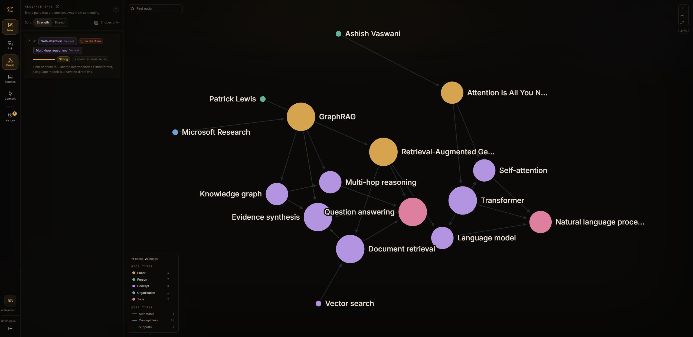
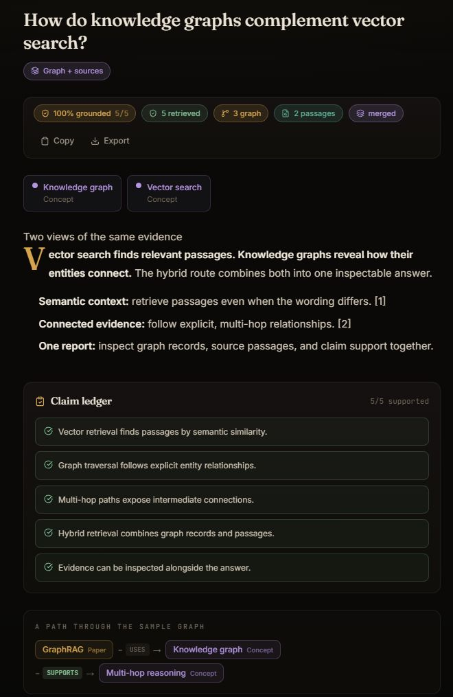
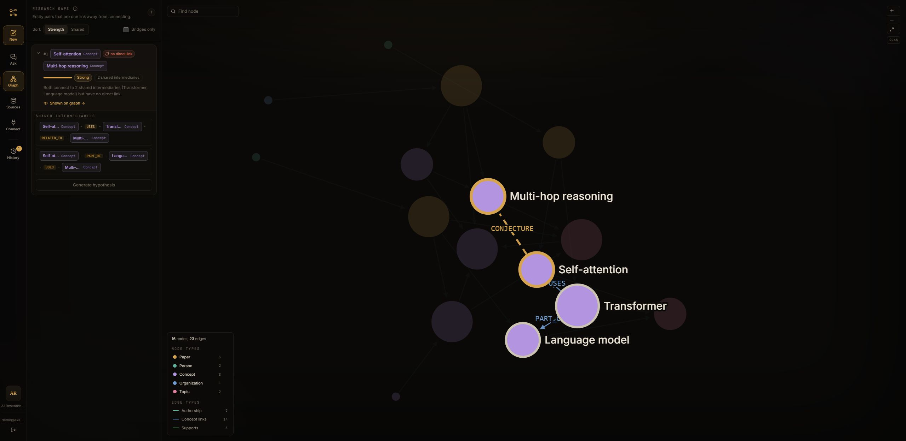
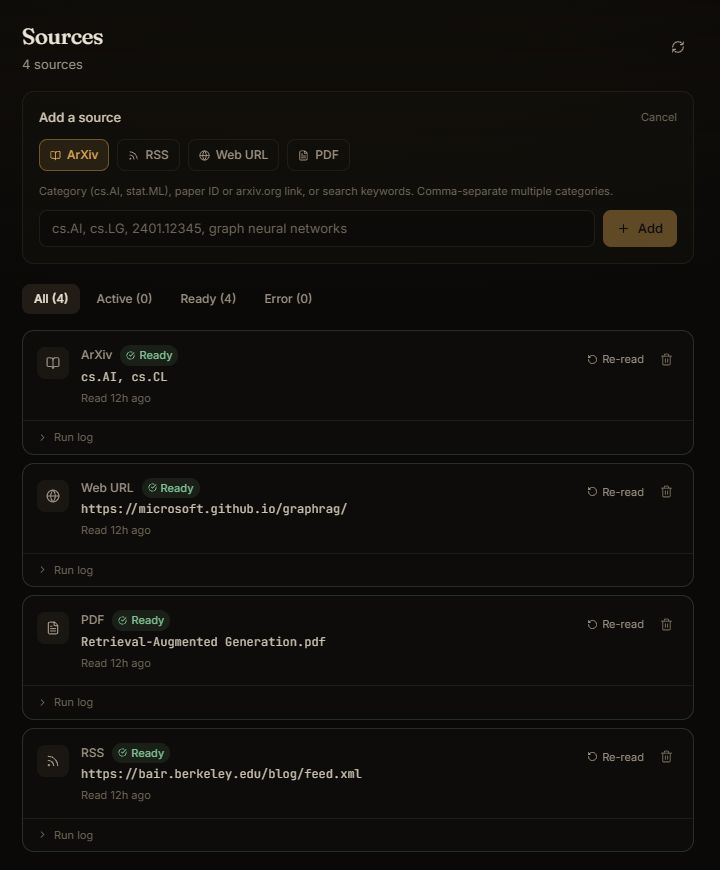
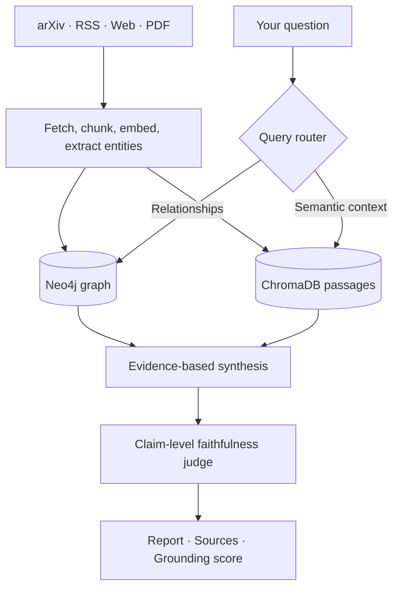

# Knowledge Graph Research Engine

**Connect the papers. Follow the evidence. Find your next question.**

A research workspace powered by knowledge graphs, semantic search, and claim-level verification.

[Open the app](https://rebanto-kgre.hf.space) · [Setup guide](docs/03-getting-started.md) · [Documentation](docs/README.md)




*The Lattice interface: explore what your sources know, and where the connections are missing.*

Bring arXiv papers, RSS feeds, web pages, and PDFs into one workspace. Ask a question in plain language; the engine routes it to **Neo4j graph traversal**, **ChromaDB vector search**, or **both**, then synthesizes an answer with inspectable evidence and a grounding score.

## Visual tour

Screenshots show the actual React frontend running locally with illustrative sample data. Answers, relationships, and scores in these images demonstrate the interface; they are not live research or benchmark results.

### 01 / Ask a question. Inspect the answer.

Move from a question to a readable report with retrieval details, source passages, and a claim ledger. Continue the conversation with follow-up questions, or enable **Deep Research** to break a broader question into parallel research steps.



### 02 / Explore the connections.

Use the interactive D3 graph shown above to browse papers, authors, concepts, and their relationships. Filter node and relationship types, focus an entity, or inspect suggested research gaps. Shared-intermediary evidence explains why a missing connection might be interesting. These suggestions are structural leads to investigate, not established findings.



### 03 / Build your source library.

Add an arXiv category, feed, web page, or PDF. Track ingestion in the source manager, then ask questions once the source is ready. Separate workspaces keep research topics organized.



## What you can do

| Capability | How it helps |
| --- | --- |
| **Graph + vector retrieval** | Combine explicit relationship paths with relevant passages; empty results can fall back to the other retriever. |
| **Claim-level grounding** | See the fraction of claims the judge finds supported and inspect unsupported claims. A score is an evidence check, not a guarantee of correctness. |
| **Deep Research** | Decompose a question, research sub-questions with bounded parallel agents, and verify the combined report. |
| **Conflict detection** | Surface contradictory source relationships through `CONFLICTS_WITH` edges and report flags. |
| **Conversations** | Ask follow-ups with bounded thread memory and standalone question rewriting. |
| **Research-gap discovery** | Find unlinked entity pairs with shared neighbors, ranked suggestions, and generated hypotheses. |
| **MCP integration** | Give an AI client semantic search, graph queries, entity context, connection tracing, conflict checks, and Deep Research. |

## Quickstart

**You need:** Docker Desktop running, Python 3.11+, Node **22.12+** with npm or pnpm, and a [Gemini API key](https://aistudio.google.com/apikey). Gemini quotas affect ingestion and research requests.

### 1. Clone and configure

```powershell
git clone https://github.com/rebanto/knowledge-graph-engine.git
cd knowledge-graph-engine
Copy-Item .env.example .env
python -c "import secrets; print(secrets.token_urlsafe(48))"
```

Edit `.env` before starting:

| Setting | Value |
| --- | --- |
| `GEMINI_API_KEY` | Your Gemini API key |
| `AUTH_SECRET_KEY` | The random value printed by the command above |
| `USE_SHARDING` | `false` for the basic single-node setup |

The remaining local database defaults match Docker Compose. See [configuration](docs/04-configuration.md) for all settings.

### 2. Start the workspace

```powershell
.\dev.ps1
```

The launcher installs dependencies and starts Neo4j, PostgreSQL, Redis, ChromaDB, the API, the ingestion worker, and the frontend. Open [localhost:5173](http://localhost:5173), create an account, and sign in.

### 3. Add sources and start exploring

1. Create a workspace for your research topic.
2. Open **Sources** and add an arXiv category such as `cs.AI`, an RSS feed, a public web page, or a PDF.
3. Wait for the source status to show **Ready**.
4. Open **Ask** for questions and follow-ups, or **Graph** to explore connections.

Try “Which concepts connect these papers?” or “What do my sources say about retrieval-augmented generation?” Answers depend on the evidence you have ingested.

Use `.\dev.ps1 -Stop` to stop the local stack. For other operating systems, follow the [manual startup guide](docs/03-getting-started.md); include `chroma` when starting infrastructure services. The [hosted app](https://rebanto-kgre.hf.space) also requires sign-in and may need time to wake after inactivity.

## How it works



Gemini handles extraction, routing, synthesis, and judging. Graph storage, traversal, entity resolution, caching, conflict detection, and ingestion coordination are implemented directly in this repository. Read the [architecture guide](docs/02-architecture.md) and [query pipeline](docs/07-query-pipeline.md) for the full path.

### Scale when you need it

The single-node path is the starting point. Optional profiles add a gRPC coordinator with a worker pool, or three Neo4j shards behind a consistent-hash router:

```bash
docker compose --profile distributed up -d
docker compose --profile sharding up -d
```

Sharding also requires `USE_SHARDING=true`. See [distributed workers](docs/09-distributed-workers.md) and [sharding trade-offs](docs/10-sharding.md) before enabling them.

## Built with

| Layer | Technology |
| --- | --- |
| Interface | React · TypeScript · Vite · D3 |
| API | FastAPI · Python |
| Graph retrieval | Neo4j · Cypher |
| Semantic retrieval | ChromaDB · sentence-transformers · cross-encoder reranking |
| State and jobs | PostgreSQL · Redis · RQ |
| Distributed ingestion | gRPC coordinator and worker pool |
| Language model | Google Gemini |
| Agent integration | Model Context Protocol |

## Evaluation and development

The repository includes a golden question set, entity-resolution checks, and graph-versus-vector and sharding benchmarks. Read the [measured results](eval_results/BENCHMARK_RESULTS.md) with their dataset, run date, and limitations, or review the [evaluation methodology](docs/18-evaluation.md).

```bash
pip install -r requirements-dev.txt
pytest
python scripts/benchmark_quality.py
python scripts/benchmark_multihop.py
python scripts/benchmark_sharding.py
```

Some integration tests require live services; benchmarks require configured stores, ingested data, and model access. For frontend checks, run `npm run lint` and `npm run build` from `frontend/`.

## Go deeper

| I want to… | Start here |
| --- | --- |
| Run and configure the engine | [Getting started](docs/03-getting-started.md) · [Configuration](docs/04-configuration.md) |
| Understand the system | [Architecture](docs/02-architecture.md) · [Data models](docs/05-data-models.md) |
| Follow a document or a question | [Ingestion](docs/06-ingestion-pipeline.md) · [Retrieval](docs/07-query-pipeline.md) |
| Integrate an app or AI client | [API reference](docs/08-api-reference.md) · [Deep Research and MCP](docs/19-deep-research-and-mcp.md) |
| Deploy and operate it | [Hugging Face deployment](docs/21-deployment.md) · [Operations](docs/15-operations.md) |
| Browse all guides | [Documentation index](docs/README.md) |
